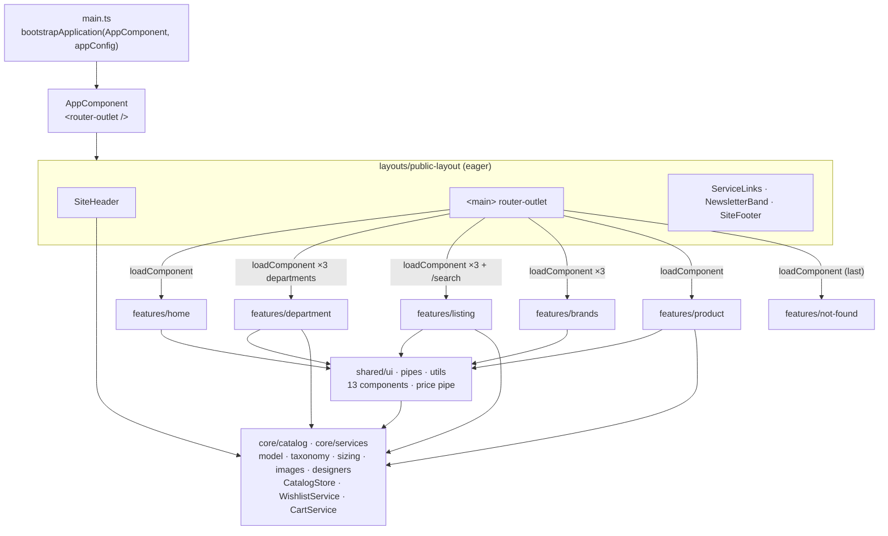
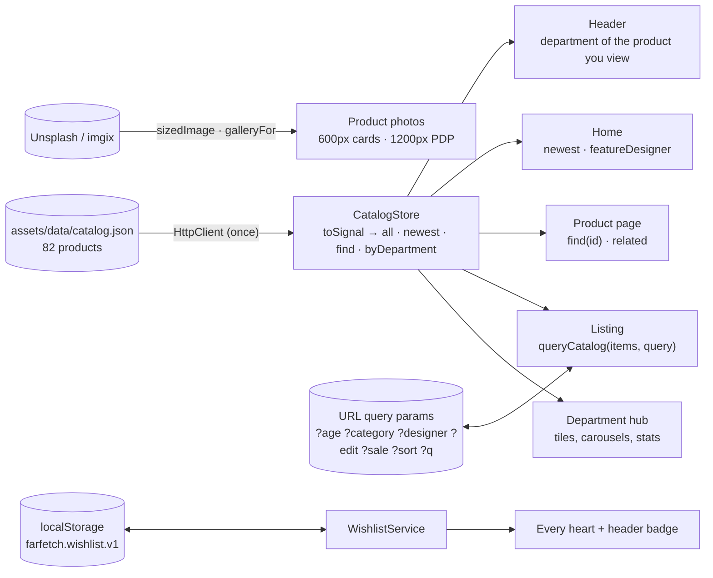

<div align="center">

# FARFETCH · Stitch Store Online

### A luxury-fashion storefront, hand-built with Angular 21: standalone, zoneless and signal-first

*Three departments (Women, Men, Kids), 82 products from 65 designers, curated edits, sale prices, age groups for kidswear, a shared wishlist and a bag. Every page follows Farfetch's own structure and one strict design system, "Monochrome Absolute".*

[](https://angular.dev)
[](https://www.typescriptlang.org/)
[](https://tailwindcss.com/)
[](https://rxjs.dev/)
[](https://vitest.dev/)
[](https://angular.dev/guide/ssr)
[](LICENSE)

</div>

---

## Table of Contents

1. [What This Project Is](#1-what-this-project-is)
2. [A Tour of the App](#2-a-tour-of-the-app)
3. [Tech Stack](#3-tech-stack)
4. [Architecture](#4-architecture)
   - [4.1 Guiding principles](#41-guiding-principles)
   - [4.2 Layer map](#42-layer-map)
   - [4.3 Route table](#43-route-table)
   - [4.4 Data flow](#44-data-flow)
   - [4.5 Bootstrapping, step by step](#45-bootstrapping-step-by-step)
5. [Project Structure](#5-project-structure)
6. [Core: Catalog, Taxonomy and State](#6-core-catalog-taxonomy-and-state)
7. [Shared: The UI Kit](#7-shared-the-ui-kit)
8. [Layout: The Storefront Shell](#8-layout-the-storefront-shell)
9. [Pages: Every Feature in Depth](#9-pages-every-feature-in-depth)
10. [The Catalog Data](#10-the-catalog-data)
11. [Product Photography](#11-product-photography)
12. [The Design System](#12-the-design-system)
13. [URL State: The Listing Query](#13-url-state-the-listing-query)
14. [State Management with Signals](#14-state-management-with-signals)
15. [Accessibility](#15-accessibility)
16. [SSR, Hydration & Security](#16-ssr-hydration--security)
17. [Testing](#17-testing)
18. [Configuration & Tooling](#18-configuration--tooling)
19. [Concept Index: Where to Learn What](#19-concept-index-where-to-learn-what)
20. [Project History: How It Grew](#20-project-history-how-it-grew)
21. [Design Decisions & Trade-offs](#21-design-decisions--trade-offs)
22. [Getting Started](#22-getting-started)
23. [Scaling the Project](#23-scaling-the-project)
24. [Roadmap & Known Gaps](#24-roadmap--known-gaps)
25. [Contributing, License & Credits](#25-contributing-license--credits)

---

## 1. What This Project Is

A study of how a real luxury marketplace is put together, rebuilt in modern Angular. The reference is
[farfetch.com](https://www.farfetch.com/): its department hubs (`/shopping/women/items.aspx`), its listing pages,
its product pages and its navigation. The visual language comes from the Stitch prototypes in `prototypes/`,
in particular `prototypes/woman_/woman8` and its `DESIGN.md`, **"Monochrome Absolute"**.

Three ideas run through every file:

| Idea | In practice |
| ---- | ----------- |
| **One source of truth** | One catalog (`CatalogStore`), one taxonomy (`taxonomy.ts`), one query function (`queryCatalog`), one product card, one heart, one price tag, one set of design tokens. |
| **Structure is code, content is data** | The three departments share **one** hub template, **one** listing and **one** product page. What differs between Women, Men and Kids lives in data (`DEPARTMENT_CONTENT`, `catalog.json`). |
| **The URL is the state** | Every listing view (`?age=baby&category=shoes&sale=true&sort=price-asc`) can be shared, bookmarked and restored with the back button. |

---

## 2. A Tour of the App

| Route | Page | What you can do |
| ----- | ---- | --------------- |
| `/` | **Home** | Choose a department ("Choose your world"), read the editorial, browse house names, featured designers and the newest arrivals across the store. |
| `/womenswear`, `/menswear`, `/kids` | **Department hub** | Farfetch's hub, in its order: seasonal campaign, *New in daily*, *Trending now*, an editorial story with its pieces, **Shop by age** (Kids only), *Shop by category*, *Trending brands* and *More to explore*. |
| `/<department>/items` | **Listing** | Farfetch's `items.aspx`: filter by age (Kids), category, designer and sale; sort by newest or price; load more. Title, description and breadcrumb name exactly what you selected. |
| `/<department>/brands` | **Brands** | Trending houses as large tiles, then every designer in the department from A to Z with its piece count. |
| `/search?q=` | **Search** | The same listing across all departments. Search is accent-insensitive (`chloe` finds *Chloé*). |
| `/product/:id` | **Product** | Gallery (full view + two detail crops), size picker with the right size run, add to bag, wishlist, details, size & fit, shipping, and *You may also like*. |
| `/anything-else` | **404** | A way back to the store. |

**The header changes with the department you're in:**

| Department | Category bar |
| ---------- | ------------ |
| Women, Men | Gifts & Party · New In · Brands · Clothing · Shoes · Bags · Accessories · Jewelry · <span>Sale</span> |
| Kids | Gifts · New In · Brands · Baby (0–36 months) · Kids (2–12 years) · Teens (13–16 years) · <span>Sale</span> |

Small touches, everywhere:

- **Wishlist:** every heart in the app reads and writes the same store, persisted in `localStorage`; the header
  badge counts saved pieces live.
- **Sale:** marked-down pieces show the sale price in red, the original struck through and the discount
  (`$225 $325 -31%`), and sorting uses the price actually paid.
- **Sizes that make sense:** a bodysuit offers `3M–24M`, a teen's sneaker `36–40 EU`, a womenswear coat `38–46 IT`;
  bags, accessories and jewelry are one size and skip the picker.
- **Quick add:** "Add to bag" appears on hover on desktop and is always visible on touch screens.
- **Breadcrumbs everywhere:** `Home / Kids / Baby / Clothing / Teddy knit hooded romper`.

---

## 3. Tech Stack

| Layer | Technology | Version | How it's used |
| ----- | ---------- | ------- | ------------- |
| Framework | **Angular** | 21.2 | Standalone components, signals, `linkedSignal`, `input()`, control flow, `withComponentInputBinding`, lazy `loadComponent` |
| Change detection | **Zoneless** | built-in | `provideZonelessChangeDetection()`; every component is `OnPush` |
| Language | **TypeScript** | 5.9 | `strict`, `strictTemplates`, `noImplicitOverride`, `noImplicitReturns`, `noPropertyAccessFromIndexSignature`, `noFallthroughCasesInSwitch` |
| Async | **RxJS** | 7.8 | HTTP + `toSignal`; router events → URL signal in the header |
| HTTP | `HttpClient` + `withFetch()` | built-in | Loads `assets/data/catalog.json` once |
| Styling | **Tailwind CSS v4** | 4.2 | `@theme` tokens and `@utility` classes in `src/styles.css`, via `@tailwindcss/postcss` |
| Font | **Inter** | Google Fonts | 300/400/500/600 |
| Build | **@angular/build** (esbuild + Vite) | 21 | `application` builder with SSR entry |
| SSR | **@angular/ssr** + **Express** | 21 / 4.22 | `AngularNodeAppEngine`, server routes (`RenderMode.Server`), hydration, hardening headers |
| Unit tests | **Vitest** | 4.0 | Node environment, pure-function specs |
| Images | **Unsplash (imgix)** | CDN | Resized and focal-point-cropped per context |

**Not used, on purpose:** no UI kit, no component library, no state library (NgRx etc.), no animation package.
Everything is Angular, Tailwind and the web platform.

---

## 4. Architecture

### 4.1 Guiding principles

1. **Feature-first, fully lazy.** Every routed page is a standalone component under `features/<name>/pages/`,
   loaded with `loadComponent`. Each page ships as its own JavaScript chunk.
2. **Products come only from `CatalogStore`.** Pages derive what they show with `computed()`. No page keeps
   its own product array or fetches data itself.
3. **Features don't import each other's internals.** What two features need lives in `core/` (data and state)
   or `shared/` (UI). The single, deliberate exception is `listing.query.ts`, a **pure** module the department
   page reuses to picture its tiles.
4. **One template per kind of page.** Women, Men and Kids are the same hub, the same listing and the same PDP.
   Departments differ through data (`DEPARTMENT_CONTENT`, the catalog), never through copied templates.
5. **Images follow the catalog.** Category, age, designer, trend and brand tiles are pictured by the newest
   product their link leads to, so a picture always matches what the user finds after clicking.
6. **The design system can't drift.** Tailwind's radius and shadow scales are removed, so `rounded-lg` or
   `shadow-md` simply don't exist. Components use the shared utilities (`btn-primary`, `label-caps`, …)
   instead of restyling.
7. **Signals for state, RxJS at the edges.** Component and service state are signals; RxJS appears only where
   Angular hands you an Observable (HTTP, router events), converted with `toSignal`.

### 4.2 Layer map



All services are `providedIn: 'root'`: tree-shakable singletons that need no registration.

### 4.3 Route table

```ts
// src/app/app.routes.ts
function departmentRoutes(path: string, id: Department): Routes {
  return [
    { path,                  loadComponent: department, data: { department: id }, title: titleFor(id) },
    { path: `${path}/items`, loadComponent: listing,    data: { department: id }, title: `${titleFor(id)} · Shop all` },
    { path: `${path}/brands`,loadComponent: brands,     data: { department: id }, title: `${titleFor(id)} · Brands` }
  ];
}

export const routes: Routes = [
  {
    path: '',
    component: PublicLayoutComponent,           // header + footer around every page
    children: [
      { path: '', loadComponent: home },
      ...departmentRoutes('womenswear', 'womenswear'),
      ...departmentRoutes('menswear', 'menswear'),
      ...departmentRoutes('kids', 'kids'),
      { path: 'search',      loadComponent: listing, data: { department: null } },
      { path: 'product/:id', loadComponent: product },
      { path: '**',          loadComponent: notFound }      // ← always last
    ]
  }
];
```

The router is configured with:

```ts
provideRouter(
  routes,
  withComponentInputBinding(),   // data.department and :id arrive as input() signals
  withInMemoryScrolling({ scrollPositionRestoration: 'enabled', anchorScrolling: 'enabled' })
)
```

Because of `withComponentInputBinding`, pages never inject `ActivatedRoute` to read their department or id:

```ts
readonly department = input.required<Department>();   // from route data
readonly id = input.required<string>();               // from /product/:id
```

Adding a department is **one line** here (`...departmentRoutes('beauty', 'beauty')`) plus its data.

### 4.4 Data flow



### 4.5 Bootstrapping, step by step

1. `main.ts` calls `bootstrapApplication(AppComponent, appConfig)`.
2. `appConfig` provides zoneless change detection, the router, `HttpClient` with the Fetch backend, client
   hydration and a `GlobalErrorHandler`.
3. The root route renders `PublicLayoutComponent`: header, `<main>`, service links, newsletter band and footer.
4. The first component that injects `CatalogStore` triggers the single `GET /assets/data/catalog.json`. Until it
   resolves, `loading()` is `true` and pages show skeletons.
5. The matching page chunk loads lazily, receives its route data as inputs and derives its view with `computed()`.
6. On the server, `main.server.ts` bootstraps the same app with `provideServerRendering(withRoutes(serverRoutes))`
   merged in; `server.ts` hands each request to `AngularNodeAppEngine`, which renders it and returns the HTML.
   In the browser, hydration takes over the server DOM.

---

## 5. Project Structure

```text
stitchFarfetchStoreOnline/
├── ARCHITECTURE.md                 Short rulebook: pages, folders, rules, tokens, components
├── README.md                       This document
├── prototypes/                     Stitch prototypes used as visual reference
│   ├── home_/  (home1–home3)
│   ├── men_/   (men_home, men1–men6)
│   └── woman_/ (womahome_, woman1–woman8 · woman8/DESIGN.md = "Monochrome Absolute")
├── src/
│   ├── index.html                  CSP meta, Inter font, <app-root>
│   ├── main.ts                     Browser bootstrap
│   ├── main.server.ts              Server bootstrap
│   ├── server.ts                   Express + AngularNodeAppEngine SSR server
│   ├── styles.css                  Tailwind v4: @theme tokens + @utility classes
│   ├── environments/               apiUrl ('/assets/data')
│   ├── assets/data/catalog.json    The catalog: 82 products
│   └── app/
│       ├── app.component.ts        <router-outlet />
│       ├── app.config.ts           Zoneless, router, HttpClient, hydration, ErrorHandler
│       ├── app.config.server.ts    + provideServerRendering(withRoutes(serverRoutes))
│       ├── app.routes.server.ts    Server render mode per route (all: RenderMode.Server)
│       ├── app.routes.ts           departmentRoutes() + search, product, 404
│       ├── core/
│       │   ├── catalog/
│       │   │   ├── catalog.model.ts      CatalogItem, Department, ProductCategory, ProductEdit, AgeGroup, prices
│       │   │   ├── taxonomy.ts           DEPARTMENTS, CATEGORIES, EDITS, AGE_GROUPS + lookups/guards
│       │   │   ├── sizing.ts             sizesFor(): size runs per department, category and age
│       │   │   ├── images.ts             sizedImage(), galleryFor() (imgix)
│       │   │   ├── designers.ts          featureDesigner(): a house's signature piece
│       │   │   ├── index.ts              Barrel
│       │   │   └── *.spec.ts
│       │   └── services/
│       │       ├── catalog.store.ts      CatalogStore, byNewest
│       │       ├── wishlist.service.ts   Persisted wishlist
│       │       ├── cart.service.ts       Bag count
│       │       └── global-error-handler.service.ts
│       ├── shared/
│       │   ├── ui/                 13 presentational components (see §7)
│       │   ├── pipes/price.pipe.ts
│       │   └── utils/price.util.ts (+ spec)
│       ├── layouts/public-layout/
│       │   ├── public-layout.component.ts
│       │   ├── site-header.component.ts
│       │   ├── service-links.component.ts
│       │   ├── newsletter-band.component.ts
│       │   └── site-footer.component.ts
│       └── features/
│           ├── home/pages/home-page.component.ts
│           ├── department/
│           │   ├── data/department-content.ts    Campaign, trends, editorial, brands per department
│           │   └── pages/department-page.component.ts
│           ├── listing/
│           │   ├── listing.query.ts              queryCatalog(), designersIn(), sorts (+ spec)
│           │   └── pages/product-listing-page.component.ts
│           ├── brands/pages/brands-page.component.ts
│           ├── product/pages/product-page.component.ts
│           └── not-found/pages/not-found-page.component.ts
├── angular.json · tsconfig*.json · vitest.config.ts · postcss.config.json
└── LICENSE                         Apache 2.0
```

**Naming:** files are kebab-case with a role suffix (`*.component.ts`, `*.service.ts`, `*.store.ts`,
`*.pipe.ts`, `*.util.ts`, `*.spec.ts`); selectors use the `app-` prefix; folders named after what they contain.

---

## 6. Core: Catalog, Taxonomy and State

### `catalog.model.ts`: the shape of a product

```ts
type Department      = 'womenswear' | 'menswear' | 'kids';
type ProductCategory = 'clothing' | 'shoes' | 'bags' | 'accessories' | 'jewelry';
type ProductEdit     = 'gifts' | 'party' | 'winter' | 'heritage';
type AgeGroup        = 'baby' | 'kids' | 'teens';

interface CatalogItem {
  id: string;            // 'ww-12', 'ms-3', 'kj-4'
  title: string;
  brand: string;
  price: number;         // original price, whole dollars
  image: string;         // one Unsplash photo
  department: Department;
  category: ProductCategory;
  description: string;
  addedAt: string;       // ISO date: "Newest first", "New In"
  badge?: string;        // "New Season"
  edits: ProductEdit[];  // curated edits, across categories
  ageGroup?: AgeGroup;   // kids only
  salePrice?: number;    // present when on sale
}
```

Two helpers keep sale logic in one place: `effectivePrice(item)` (what the customer pays) and
`discountPercent(item)` (`31` for `$225` off `$325`).

### `taxonomy.ts`: the vocabulary

Every label the UI shows comes from here, never from a template string:

| Constant | Values | Used by |
| -------- | ------ | ------- |
| `DEPARTMENTS` | Women, Men, Kids (+ possessive "Women's", path) | Header, breadcrumbs, titles, routes |
| `CATEGORIES` | Clothing, Shoes, Bags, Accessories, Jewelry (Farfetch's order) | Header, filters, tiles |
| `EDITS` | Gifts, Party Looks, The Winter Edit, Modern Heritage (+ description) | Listing titles, hub campaigns |
| `AGE_GROUPS` | Baby (0–36 months), Kids (2–12 years), Teens (13–16 years) (+ description) | Kids header, Age filter, Shop by age, PDP breadcrumb |

Each comes with a lookup (`departmentInfo`, `categoryLabel`, `editInfo`, `ageGroupInfo`) and a **type guard**
(`isDepartment`, `isCategory`, `isEdit`, `isAgeGroup`). The guards are how untrusted URL params become typed
values: `?age=adults` is simply ignored.

### `sizing.ts`: size runs

`sizesFor(item)` returns the run for a department, category and, for kids, age group:

| | Clothing | Shoes |
| - | -------- | ----- |
| Women | 38–46 IT | 36–40 EU |
| Men | 46–54 IT | 40–44 EU |
| Kids · Baby | 3M–24M | 17–21 EU |
| Kids · Kids | 4Y–12Y | 28–34 EU |
| Kids · Teens | 13Y–16Y | 36–40 EU |

Bags, accessories and jewelry return `[]`, and the product page hides the size picker.

### `images.ts` and `designers.ts`

See [§11 Product Photography](#11-product-photography).

### `CatalogStore`: the only product source

```ts
@Injectable({ providedIn: 'root' })
export class CatalogStore {
  private readonly items = toSignal(
    inject(HttpClient).get<CatalogItem[]>(`${environment.apiUrl}/catalog.json`)
      .pipe(catchError(() => of([] as CatalogItem[]))),
    { initialValue: null }
  );

  readonly loading = computed(() => this.items() === null);
  readonly all     = computed(() => this.items() ?? []);
  readonly newest  = computed(() => [...this.all()].sort(byNewest));

  byDepartment(department: Department): CatalogItem[] { … }
  find(id: string): CatalogItem | undefined { … }
}
```

- **One request, ever.** The HTTP Observable is turned into a signal at construction.
- **`null` means loading**, `[]` means loaded-but-empty (or failed), so pages can tell skeletons from
  "no results".
- Swapping the JSON for a real API is a change to this one class.

### `WishlistService`

A `signal<ReadonlySet<string>>` of product ids with `has()`, `toggle()` and `count`. It is persisted under
`farfetch.wishlist.v1`, read defensively (non-arrays and non-strings are dropped, invalid JSON yields an empty
set) and guarded with `typeof localStorage` so it is safe during SSR and in private browsing.

### `CartService`

A signal of added ids and a `total` count shown on the bag icon. Intentionally minimal: there is no checkout.

### `GlobalErrorHandler`

Registered as Angular's `ErrorHandler`; the single place to plug in error reporting.

---

## 7. Shared: The UI Kit

Every component is standalone, `OnPush`, and takes signal `input()`s. Rule: **one component per need**.

| Need | Component | Inputs (main) | Notes |
| ---- | --------- | ------------- | ----- |
| A product in a grid | `<app-product-card>` | `item`, `eager` | 3:4 image, heart, badge, brand in label caps, title, price, quick add. 600px images; `eager` for above-the-fold cards |
| A heart | `<app-wishlist-button>` | `productId`, `label` | Reads/writes `WishlistService`; `aria-pressed` |
| Any price | `<app-price-tag>` | `item`, `size` | Sale price in red, original struck through, `-31%` |
| A section title | `<app-section-header>` | `title`, `eyebrow`, `description`, `actionLabel`, `actionLink` | Opens every section |
| A breadcrumb | `<app-breadcrumb>` | `items: Crumb[]` | Last crumb is the current page (`aria-current`) |
| A department hero | `<app-page-hero>` | `image`, `alt`, `eyebrow`, `title`, `text`, `primary`, `secondary`, `stats` | Full-bleed photo, scrim, up to two actions and stats |
| A rail of products | `<app-product-carousel>` | `title`, `items`, `eyebrow`, `actionLabel`, `actionLink` | Scroll-snap; arrow buttons appear only when there's more to see |
| "Trending now" | `<app-edit-tiles>` | `tiles`, `title` | Four doorway tiles into edits or designers |
| An editorial story | `<app-editorial-story>` | `eyebrow`, `title`, `text`, `image`, `alt`, `link` | Projects a carousel of the story's pieces (`<ng-content>`) |
| "Trending brands" | `<app-brand-tiles>` | `brands`, `title`, `actionLink` | House name over the photo with a scrim |
| A designer tile | `<app-designer-card>` | `name`, `eyebrow`, `image`, `from`, `link` | "From $X" entry price |
| A row of house names | `<app-brand-strip>` | `brands` | Quiet divider between sections |
| Closing link lists | `<app-link-directory>` | `columns`, `label` | Gifts / Party Season / Holiday Styles |

Plus:

- **`price` pipe** → `formatPrice()`: `$2,950`, always whole dollars.
- **`shared/ui/index.ts`**: a barrel for the kit.

---

## 8. Layout: The Storefront Shell

`PublicLayoutComponent` wraps every page:

```html
<app-site-header />
<main id="main"><router-outlet /></main>
<app-service-links />      <!-- How to shop · FAQs · Need help? -->
<app-newsletter-band />    <!-- "Never miss a thing": Email / SMS -->
<app-site-footer />        <!-- four link columns + legal line -->
```

### `SiteHeader`

- **Promo bar** ("Free shipping on orders over $200"), then a sticky header: departments on the left, the
  FARFETCH wordmark centered, search, wishlist, bag and account on the right.
- **The active department** is derived from the URL (`/kids/items` → Kids). On a product page it is the
  product's department (`/product/kj-4` → Kids), looked up in `CatalogStore`.
- **The category bar** (`navLinks`, a `computed`) lists the active department's ways in: categories for Women
  and Men, **age groups** for Kids. The active link is bold through `routerLinkActive` with
  `queryParams: 'subset'`, so `Baby (0–36 months)` stays active on `?age=baby&category=shoes`.
- **Search** submits to `/search?q=…` and keeps the term in the box while you're on its results.
- **Mobile:** a menu button opens the departments and the same category links; the badges show wishlist and
  bag counts (`aria-live` on the bag).

### `NewsletterBand`

A channel choice (Email / SMS) and an input validated for the chosen channel, all with signals
(`channel`, `contact`, `subscribed`, `valid`).

---

## 9. Pages: Every Feature in Depth

### 9.1 Home: `/`

The department chooser (three 3:4 photos), an editorial block, a brand strip, *This season's designers*
(each pictured with `featureDesigner()`) and *New In* across the store, with skeletons while the catalog loads.

### 9.2 Department hub: `/womenswear`, `/menswear`, `/kids`

**One component for all three**, receiving `department` from route data. In Farfetch's order:

| Section | Source |
| ------- | ------ |
| Campaign hero + stats (designers, "prices from", pieces) | `DEPARTMENT_CONTENT[dept].campaign` + catalog |
| *New in daily from the best brands* (carousel of 12) | Catalog, newest first |
| *Trending now* (4 tiles) | `content.trends`: each tile is a set of listing filters, pictured with the first matching piece via `queryCatalog`, never repeating a photo |
| Editorial story + its pieces | `content.editorial`, items in its edit |
| **Shop by age** (Kids only) | `AGE_GROUPS`; tile = newest piece of the group not already used in *Trending now*, with piece count |
| *Shop by category* | One tile per category the department actually stocks; responsive column count from the number of tiles |
| *Trending brands* | `content.brands` + `featureDesigner()` |
| *More to explore* | Generated link columns (gifts, party, holiday styles), each a filtered listing |

### 9.3 Listing: `/<department>/items` and `/search`

The heart of the store. Everything is read from the URL and derived with signals:

```text
URL params ──► age, category, designer, edit, sale, search, sort   (typed via guards)
                      │
pool    = queryCatalog(all, { department, age, edit, sale, search })   → what the filters may offer
results = queryCatalog(pool, { category, designer, sort })              → what the grid shows
limit   = linkedSignal(results → PAGE_SIZE)                              → "Load more" resets on new results
visible = results.slice(0, limit)
```

- **Filters:** Age (only when the department's items carry an age group), Category, Designer, Sale only,
  Clear all, Sort by. Options come from the *pool*, so a filter never offers a choice that leads to an empty page.
- **Title precedence:** edit / sale → age group ("Baby Clothing", "Teens (13–16 years)") → category
  ("Women's Bags") → "New In". The description follows the same logic.
- **Breadcrumb:** `Home / Kids / Teens / Shoes`; the middle crumb links back when a category narrows it.
- **States:** skeleton grid while loading, the grid, a progress line with "Load more", or "No items match your
  selection" with a Clear all button.
- **Accessibility:** the result count is `aria-live`.

### 9.4 Brands: `/<department>/brands`

The houses with the most pieces as tiles, then every designer in the department grouped by initial (A–Z), each
with its piece count and a link to its filtered listing.

### 9.5 Product: `/product/:id`

- `id` arrives as an input, so following a recommendation re-derives the whole page.
- **Gallery** from `galleryFor()`: full view + two focal-point crops, thumbnails with `aria-pressed`.
- **Sizes** from `sizesFor()`; "Add to bag" asks for a size first when the product has a run.
- **Per-product UI state** (`selectedSize`, `added`, `activeImage`, `needsSize`) uses `linkedSignal` with the
  id as source, so it resets automatically when you move to another product.
- **Breadcrumb:** `Home / Women / Clothing / …`; for kids, `Home / Kids / Baby / Clothing / …`.
- **Details / Size & fit / Shipping & returns** as native `<details>` accordions.
- **You may also like:** same department, same category first, newest first.

### 9.6 Not found: `**`

The last route; a message and a way back.

---

## 10. The Catalog Data

`src/assets/data/catalog.json` holds **82 products** from **65 designers**:

| | Count |
| - | ----- |
| Womenswear / Menswear / Kids | 33 / 25 / 24 |
| Clothing / Shoes / Bags / Accessories / Jewelry | 32 / 14 / 13 / 12 / 11 |
| On sale | 17 |
| Edits: Gifts / Party / Winter / Heritage | 28 / 25 / 18 / 11 |
| Kids by age: Baby / Kids / Teens | 5 / 12 / 7 |

Rules for the data:

- Ids are prefixed by department (`ww-`/`wb-` women, `ms-` men, `kj-` kids).
- `price` is always the original; a markdown adds `salePrice` (lower than `price`).
- `ageGroup` only on kids items; `edits` may be empty.
- **No photo is used twice**, and every photo must show the product it names (see below).

---

## 11. Product Photography

All product photos are Unsplash images served through **imgix**, which resizes and crops on the fly:

| Helper | What it does |
| ------ | ------------ |
| `sizedImage(url, width)` | Requests the width the UI needs: 600px for cards, 1200px for the PDP. Non-imgix URLs pass through unchanged. |
| `galleryFor(url)` | Builds a 3-image PDP gallery from **one** photo: the full view plus two `crop=focalpoint` zooms (`fp-y` 0.32 × 2.2 and 0.7 × 2.6), the detail shots a luxury PDP shows. |
| `featureDesigner(items, name)` | Pictures a house by its most representative piece: clothing first, then bags, shoes, accessories, jewelry; newest within that. Also returns its lowest price. |

**Curation rules** (every photo was checked by eye):

1. The photo shows the product named in the title.
2. No visible logos of *other* brands (no Nike swoosh on a Gucci sneaker).
3. No adult model on a kids item.
4. One photo, one product.

---

## 12. The Design System

The reference is `prototypes/woman_/woman8/DESIGN.md`, **"Monochrome Absolute"**: a monochrome palette, sharp
0px corners, no shadows, light display type and uppercase micro-labels. Everything lives in `src/styles.css`
(Tailwind v4 reads CSS, not `tailwind.config.js`).

### 12.1 Tokens (`@theme`)

| Token | Value | Utilities | Use |
| ----- | ----- | --------- | --- |
| `ink` | `#000000` | `text-ink`, `bg-ink`, `border-ink` | Text, primary buttons |
| `canvas` | `#ffffff` | `bg-canvas`, `text-canvas` | Page background, text on photos |
| `surface` | `#f5f5f5` | `bg-surface` | Image placeholders, skeletons |
| `line` | `#e5e5e5` | `border-line` | Dividers |
| `muted` | `#767676` | `text-muted` | Secondary text, breadcrumbs |
| `error` | `#ba1a1a` | `text-error` | Sale prices, Sale link, errors |
| Font | Inter | `font-sans` | Everything |

```css
--radius-*: initial;   /* rounded-lg doesn't exist */
--shadow-*: initial;   /* shadow-md doesn't exist */
```

`rounded-full` remains only for functional circles (the heart button, count badges).

### 12.2 Utilities (`@utility`)

| Group | Utility | Use for |
| ----- | ------- | ------- |
| Layout | `page-container` | Every page's frame: 1440px max, 20px / 64px margins |
| | `section-y` | Vertical rhythm between sections (4rem → 6rem) |
| | `product-grid` | Every product grid: 2 → 3 → 4 columns |
| Type | `text-display` | Hero headlines (light, large) |
| | `text-headline` | Page and section titles |
| | `text-title` | Sub-titles (brand on the PDP, tile names) |
| | `label-caps` | Brands, nav, eyebrows, small labels (uppercase, tracked) |
| Controls | `btn` + `btn-primary` / `btn-secondary` | Buttons on white (they invert on hover) |
| | `btn` + `btn-light` / `btn-outline-light` | Buttons on photography |
| | `link-cta` | "View all", "Size guide", "Clear all" |
| | `input-line` | Text inputs (bottom border only) |
| | `select-line` | Filter and sort selects |
| | `quick-add` | Card action revealed on hover; always visible where there's no hover |
| | `no-scrollbar` | Carousels and thumbnail rails |

### 12.3 Patterns

- **Photo tiles:** `aspect-[3/4]` (products, ages, departments) or `aspect-square` (categories), `overflow-hidden`,
  `group-hover:scale-105` over 700ms, `bg-surface` while loading.
- **Text on photos:** always over a scrim (`bg-black/35` or a bottom gradient), never directly on the image.
- **Focus:** `:focus-visible` draws a 1px ink outline with a 3px offset on every interactive element.

---

## 13. URL State: The Listing Query

| Param | Values | Effect |
| ----- | ------ | ------ |
| `age` | `baby` · `kids` · `teens` | Kids age group |
| `category` | `clothing` · `shoes` · `bags` · `accessories` · `jewelry` | Category |
| `designer` | a brand name (`Prada`) | Designer |
| `edit` | `gifts` · `party` · `winter` · `heritage` | Curated edit |
| `sale` | `true` | Only marked-down pieces |
| `sort` | `newest` · `price-asc` · `price-desc` | Order (by price actually paid) |
| `q` | free text | Search over brand, title and category, case- and accent-insensitive |

Examples:

```text
/kids/items?age=baby
/kids/items?age=teens&category=shoes
/womenswear/items?edit=gifts&sort=price-asc
/menswear/items?designer=Saint%20Laurent&sale=true
/search?q=chloe
```

The whole filter/sort logic is **one pure function**, `queryCatalog(items, query)`, plus `designersIn(items)`
for the designer options. Pages only parse params, call it and render, which is why it is the most tested
piece of the app.

---

## 14. State Management with Signals

| Kind of state | Where | Tool |
| ------------- | ----- | ---- |
| Server data (catalog) | `CatalogStore` | `toSignal(http.get(…))` |
| App-wide UI state | `WishlistService`, `CartService` | `signal` + `computed` |
| Persisted state | `WishlistService` | `localStorage`, validated on read |
| Navigation state | URL query params | Router + `computed` from `queryParamMap` |
| Route inputs | `department`, `id` | `input.required()` via `withComponentInputBinding` |
| Derived views | every page | `computed` |
| Local state that resets with a source | listing `limit`, PDP size/image/added | `linkedSignal({ source, computation })` |
| Local UI state | header menu, newsletter form | `signal` |

There is no `effect()` that writes state and no manual subscription: zoneless change detection is driven
entirely by signals and template events.

---

## 15. Accessibility

- Landmarks: `<header>`, `<nav aria-label="Departments">`, `<nav aria-label="… categories">`, `<main id="main">`,
  `<footer>`; sections labelled with `aria-labelledby`.
- `aria-current="page"` on the active department and the last breadcrumb.
- `aria-pressed` on hearts, sizes and gallery thumbnails; `aria-expanded` on the mobile menu.
- `aria-live` on the result count and the bag badge.
- Every icon-only button has an `aria-label` ("Wishlist, 3 items"); decorative SVGs are `aria-hidden`.
- Real `<select>`, `<input type="checkbox">` and `<details>` elements: keyboard support for free.
- Visible focus ring on every interactive element; quick add appears on `:focus-visible` too.

---

## 16. SSR, Hydration & Security

- **SSR:** `angular.json` declares `server: src/main.server.ts`, `ssr.entry: src/server.ts` and
  `outputMode: "server"`, so `ng build` emits `dist/stitch-farfetch-store-online/{browser,server}`.
  `server.ts` serves the hashed files from `browser/` with `maxAge: 1y` and hands every other request to
  `AngularNodeAppEngine`. `app.routes.server.ts` renders all routes per request (`RenderMode.Server`), since the
  listing depends on query params. `ng serve` uses the same server through the exported `reqHandler`.
- **Catalog on the server:** the relative `GET /assets/data/catalog.json` is resolved against the incoming
  request, so server-rendered pages already contain products; the response is transferred to the browser
  with the page (hydration's HTTP transfer cache), so the client doesn't fetch it again.
- **Allowed hosts (SSRF protection):** `security.allowedHosts` in `angular.json` lists the hostnames the server
  will render for (`localhost`, `127.0.0.1`). Add your production domain there before deploying; unknown hosts
  fall back to client-side rendering.
- **Hydration:** `provideClientHydration()` reuses the server DOM instead of re-rendering it.
- **SSR-safe code:** browser-only APIs are guarded (`typeof localStorage`), and DOM measurement in the carousel
  runs in `afterNextRender`.
- **Headers:** `X-Content-Type-Options: nosniff` and `X-Frame-Options: DENY` on every response.
- **CSP** (in `index.html`): `default-src 'self'`; scripts only from self; images from https; fonts from Google
  Fonts.
- **XSS:** no `innerHTML` and no `bypassSecurityTrust*`; all content goes through Angular bindings. URL params are
  validated with type guards before use.

---

## 17. Testing

Tests run with **Vitest** in a Node environment (`npm test`): **24 tests across 6 files**, all green.

| Spec | What it proves |
| ---- | -------------- |
| `listing.query.spec.ts` (10) | Department, category, designer and search filters; accent-insensitive search; sort by newest/price using the sale price; edits and sale; **age groups**; no input mutation; `designersIn` sorted and unique |
| `images.spec.ts` (4) | `sizedImage` sets the width on imgix and leaves other hosts alone; `galleryFor` builds full + two focal-point crops, one image for non-imgix |
| `designers.spec.ts` (3) | `featureDesigner` prefers clothing, then newest; returns the lowest price; `null` for unknown houses |
| `sizing.spec.ts` (3) | Kids sizes follow the age group (3M… for baby clothing, 36 EU… for teen shoes); adult runs unchanged; one-size categories return `[]` |
| `catalog.model.spec.ts` (2) | `effectivePrice` and `discountPercent` |
| `price.util.spec.ts` (2) | `$2,950` formatting and rounding |

**Why the tests target pure functions:** the logic that matters (what a listing shows, which size run, which
photo pictures a designer) lives in plain functions extracted from components. They are tested without
rendering anything, run in ~100ms, and pages stay thin.

**Visual QA:** layout changes are verified with headless Chrome screenshots at 1440px and 600px.

---

## 18. Configuration & Tooling

| File | Notable settings |
| ---- | ---------------- |
| `angular.json` | `@angular/build:application`; `outputPath: dist/stitch-farfetch-store-online`; `browser: src/main.ts`, `server: src/main.server.ts`, `ssr.entry: src/server.ts`, `outputMode: server`; `security.allowedHosts`; no polyfills (zoneless, no `zone.js` installed); styles `src/styles.css`; dev server defaults to `development` |
| `tsconfig.json` | `ES2022`, `moduleResolution: bundler`, `strict`, `noImplicitOverride`, `noPropertyAccessFromIndexSignature`, `noImplicitReturns`, `noFallthroughCasesInSwitch`; Angular `strictTemplates` |
| `postcss.config.json` | `@tailwindcss/postcss` |
| `vitest.config.ts` | `environment: 'node'`, `include: src/**/*.spec.ts`, `vite-tsconfig-paths` |
| `src/environments/*` | `apiUrl: '/assets/data'` (the catalog's base URL) |
| `package.json` | Scripts `start`, `build`, `build:ssr`, `serve:ssr`, `test`, `test:watch` |

---

## 19. Concept Index: Where to Learn What

### Angular

| Concept | Where |
| ------- | ----- |
| `bootstrapApplication`, `ApplicationConfig` | `main.ts`, `app.config.ts` |
| Zoneless change detection | `app.config.ts` |
| `mergeApplicationConfig`, SSR bootstrap | `app.config.server.ts`, `main.server.ts`, `server.ts` |
| Server routes and render modes | `app.routes.server.ts` |
| Lazy `loadComponent`, route factories | `app.routes.ts` (`departmentRoutes`) |
| Route `data` / params as inputs | `withComponentInputBinding` + `department-page`, `product-page` |
| `routerLinkActive` with query params | `site-header.component.ts` |
| Router events → signal | `site-header.component.ts` (`toSignal(router.events…)`) |
| `toSignal` over HTTP | `catalog.store.ts` |
| `signal`, `computed` | everywhere |
| `linkedSignal` | `product-listing-page` (`limit`), `product-page` (size, image, added) |
| `input()`, `input.required()` | every shared component |
| `viewChild`, `afterNextRender` | `product-carousel.component.ts` |
| Content projection | `editorial-story.component.ts` |
| `@if`, `@for … track`, `@else if`, `@empty` | listing, home |
| Pure pipe | `price.pipe.ts` |
| Custom `ErrorHandler` | `global-error-handler.service.ts` |

### TypeScript

| Concept | Where |
| ------- | ----- |
| String literal unions as domain types | `catalog.model.ts` |
| User-defined type guards (`value is AgeGroup`) | `taxonomy.ts`, `listing.query.ts` |
| `Pick<>` for narrow function inputs | `sizesFor`, `effectivePrice`, `PriceTag` |
| `Record<Union, …>` lookup tables | `sizing.ts`, `department-content.ts` |
| `ReadonlyArray`, readonly tuples | `taxonomy.ts`, `DepartmentContent.trends` |

### CSS & the platform

| Concept | Where |
| ------- | ----- |
| Tailwind v4 `@theme` / `@utility` | `styles.css` |
| Removing a theme scale (`--radius-*: initial`) | `styles.css` |
| `@media (hover: hover)` | `quick-add` utility |
| Scroll snap | `product-carousel` |
| `aspect-ratio`, `object-fit` | tiles and cards |
| imgix URL API (resize, focal-point crop) | `images.ts` |
| `<details>` accordions | `product-page` |
| `localStorage` with validation | `wishlist.service.ts` |

---

## 20. Project History: How It Grew

Work happens on feature branches merged with `--no-ff` into `develop`, then fast-forwarded to `main`.

| Stage | Branch | What was built |
| ----- | ------ | -------------- |
| **Scaffold** | `codex/…` (PR #1) | Angular 21-style storefront: standalone, zoneless, SSR, Tailwind, Vitest |
| **Laboratories** | `features/home-laboratory`, `features/men-laboratory`, `features/woman-laboratory` | Stitch prototypes (`prototypes/`) and first home, menswear, kidswear and womenswear practice components |
| **Coherence** | `features/design-system` | Monochrome Absolute tokens and utilities; one catalog, one taxonomy, a shared wishlist; the UI kit; Farfetch header and single footer; one department template, one listing, one PDP; `ARCHITECTURE.md` |
| **Population** | `features/improvement1` | Kids accessories and jewelry; 82 products with verified photos; sized images and the generated gallery |
| **Farfetch hub** | `features/improvement2` | Edits and sale prices; page hero, carousels, trending tiles, editorial story, brand tiles, link directory; service links and newsletter band; the A–Z brands page |
| **Kids by age** | `features/improvement3` | `AgeGroup`, Kids nav (Baby / Kids / Teens), `?age=` filter, age-based sizes, PDP breadcrumb, *Shop by age* |
| **Documentation & SSR** | `features/improvement4` | This README; working SSR with `AngularNodeAppEngine`, server routes and allowed hosts; `zone.js` removed |

---

## 21. Design Decisions & Trade-offs

| Decision | Why | Trade-off |
| -------- | --- | --------- |
| **Static JSON catalog** | No backend needed; the store is fully explorable and deterministic | No real inventory; changing products means editing JSON |
| **One template per page type** | Three departments can't drift apart; a fix lands everywhere | Department-specific layouts need data flags (e.g. Shop by age appears only when items carry an age group) |
| **URL as listing state** | Shareable, bookmarkable, back-button friendly | Params must be validated (type guards) |
| **Pure `queryCatalog`** | Fully testable, reused by the hub's tiles | Filtering is client-side, fine for hundreds of items, not for millions |
| **Tiles pictured from the catalog** | A tile's image always matches where it leads | Less art direction than hand-picked campaign images |
| **One photo + imgix crops for galleries** | Rich PDPs with a single curated photo per product | Crops are approximations of real detail shots |
| **Removing Tailwind's radius/shadow scales** | The flat, sharp look can't be broken by accident | Needs `rounded-full` as the one explicit exception |
| **Zoneless + OnPush + signals** | Predictable, minimal change detection; no zone.js patching | Every state change must go through a signal or an event |
| **`localStorage` wishlist** | Works without an account | Per device and browser |

---

## 22. Getting Started

**Prerequisites:** Node.js 20.19+ / 22.12+ (Angular 21's range) and npm.

```bash
git clone https://github.com/CristianSifuentes/stitchFarfetchStoreOnline.git
cd stitchFarfetchStoreOnline
npm install
npm start            # → http://localhost:4200
```

| Script | Command | Purpose |
| ------ | ------- | ------- |
| `npm start` | `ng serve` | Dev server with live reload |
| `npm run build` | `ng build` | Production build → `dist/stitch-farfetch-store-online/{browser,server}` |
| `npm test` | `vitest run` | Unit tests, single run |
| `npm run test:watch` | `vitest` | Unit tests in watch mode |
| `npm run build:ssr` | `ng build` | Same build (the SSR bundle is always produced) |
| `npm run serve:ssr` | `node dist/…/server/server.mjs` | Serves the server-rendered app on `PORT` (default 4000) |

**Try this tour:**

1. Open **Kids** and use the category bar: *Baby (0–36 months)*.
2. Narrow with **Category → Shoes**, then switch the age to *Teens*. Watch the title and breadcrumb.
3. Open a baby item: the sizes read `3M · 6M · 12M · 18M · 24M`.
4. Heart a few pieces and see the header badge; reload, they're still there.
5. Visit **Women → Sale** and sort *Price: low to high*.
6. Search for `chloe` (no accent).
7. Open **Men → Brands** and pick a house from the A–Z list.

---

## 23. Scaling the Project

### Adding a product

Add an entry to `catalog.json` (unique id and photo, `edits`, `ageGroup` for kids, optional `salePrice`).
It appears in its department hub, listings, search, brands and recommendations automatically.

### Adding a category, edit or age group

1. Extend the union in `catalog.model.ts`.
2. Add it to `CATEGORIES` / `EDITS` / `AGE_GROUPS` in `taxonomy.ts` (label, and description where required).
3. For categories with sizes, add a run in `sizing.ts`.

Header links, filters, titles and tiles pick it up; tiles only appear where products exist.

### Adding a department

1. Add it to `Department` and `DEPARTMENTS`.
2. Add its size runs in `sizing.ts`.
3. Add its campaign, trends, editorial and brands to `DEPARTMENT_CONTENT`.
4. Add `...departmentRoutes('path', 'id')` in `app.routes.ts` (before `**`).

### Adding a page or a shared piece

| Adding a… | Put it in | Then |
| --------- | --------- | ---- |
| Page | `features/<name>/pages/<name>-page.component.ts` | A `loadComponent` route before `**` |
| Component used by 2+ features | `shared/ui/<name>/` | Export it from `shared/ui/index.ts` |
| Value formatter | `shared/pipes/` (+ a util in `shared/utils/`) | Spec for the util |
| App-wide state | `core/services/` with `providedIn: 'root'` | Signals, not Subjects |
| Pure domain logic | `core/catalog/` or next to its feature | A `*.spec.ts` |
| Visual pattern | A `@utility` in `styles.css` | Document it in §12 and `ARCHITECTURE.md` |

---

## 24. Roadmap & Known Gaps

- [ ] Bag drawer and checkout flow (`CartService` currently counts items).
- [ ] Wishlist page listing saved pieces.
- [ ] Component tests for the listing and product pages; E2E (Playwright) for filters and the Kids nav.
- [ ] A real API behind `CatalogStore` with server-side filtering and pagination.
- [ ] i18n (es-MX, like Farfetch's `/mx/` storefront) and currency formatting.
- [ ] Image `srcset` / `NgOptimizedImage` for responsive photo sizes.

---

## 25. Contributing, License & Credits

**Contributing:**

1. Branch from `develop` (`features/<name>`). Features merge into `develop` with `--no-ff`, then into `main`.
2. Follow the structure: pages in `features/`, cross-feature UI in `shared/ui/`, data and state in `core/`.
3. Use the design system: tokens and utilities from `styles.css`, the shared components from §7.
4. Before merging:
   - `npm run build` must be clean.
   - `npm test` must be green, with a spec for new logic.
   - Check new photos against the curation rules in §11.

**License:** [Apache 2.0](LICENSE).

**Credits:**

- Product photography: [Unsplash](https://unsplash.com/) photographers, served through imgix.
- Font: [Inter](https://rsms.me/inter/) via Google Fonts.
- Visual prototypes: generated with Stitch (`prototypes/`).

**Disclaimer:** an educational architecture project inspired by Farfetch's marketplace domain and UI patterns.
FARFETCH and the designer names are trademarks of their respective owners; this project is not affiliated with
or endorsed by them. See the original site at <https://www.farfetch.com/>.

### Further reading

- https://dev.to/kafeel-ahmad/deploying-angular-in-2026-an-architects-guide-to-build-once-run-everywhere-34eh
- https://dev.to/cristiansifuentes/13-angular-concepts-you-must-master-before-your-next-interview-2026-edition-5b74
- https://medium.com/@sanikapatil0213/folder-structures-that-scale-angular-architecture-for-big-teams-decb717e1f94
- https://medium.com/@flaviusson/angular-20-to-21-transition-guide-breaking-changes-best-practices-and-migration-paths-2026-9a66338ac33e
- https://khizaruddins.medium.com/modern-angular-enterprise-architecture-2026-beff3d0b928f

### References

file:///Users/cristian/Documents/workspace/angular/stitchFarfetchStoreOnline/prototypes/woman_/woman1/code.html
https://www.youtube.com/watch?v=aSdAZHansJU
